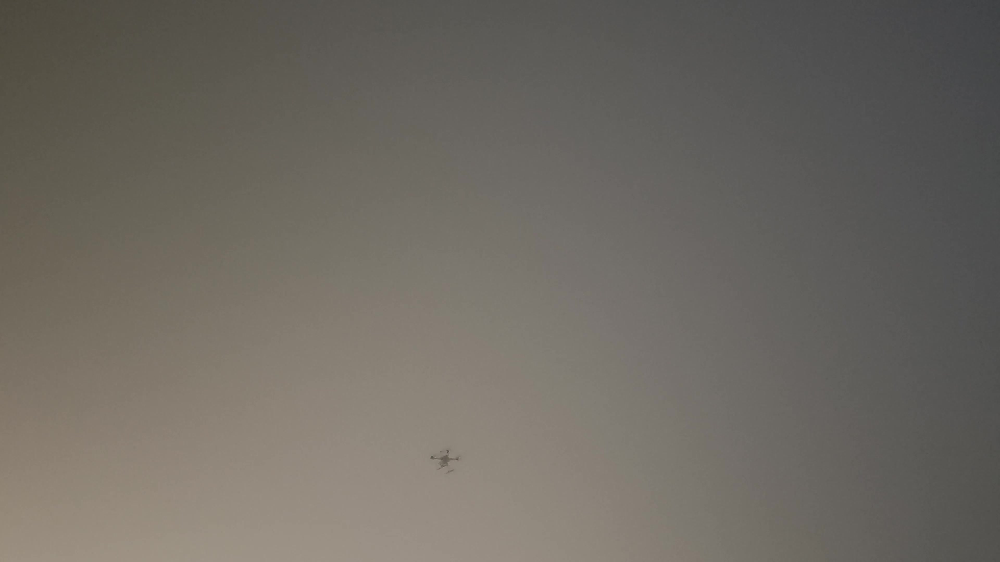
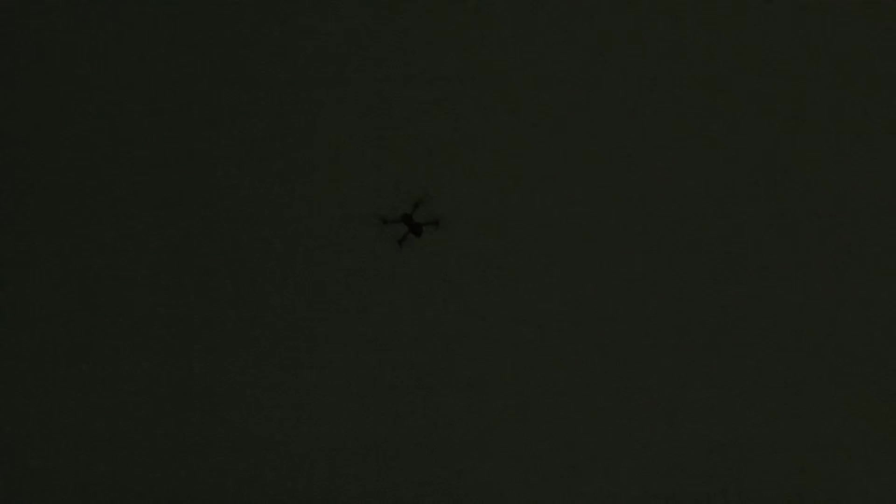

# NF-UAVTrack 数据集（中文说明）

简体中文 | [English](README.md)

NF-UAVTrack 是由 **caizhexuan（蔡喆炫）** 创建的数据集，包含 **25 条视频序列、12,127 张抽帧图像及 10,936 个无人机目标框**。本仓库为研究者提供下载入口、标注说明和数据统计。

| 视频序列 | 图像帧 | 目标框 | 图像分辨率 |
| ---: | ---: | ---: | --- |
| 25 | 12,127 | 10,936 | 3840 × 2160、1920 × 1080 |

## 数据预览

| video01 / frame-000001 | video25 / frame-000001 |
| --- | --- |
|  |  |

以上为未经修改的原始图像帧，对应标注文件见 [examples/](examples/)。

## 数据集下载

| 下载平台 | 链接 | 提取码 |
| --- | --- | --- |
| 百度网盘 | [下载 NF-UAVTrack.zip](https://pan.baidu.com/s/1dzHpwilAFCqUif20WGW_OA?pwd=0854) | `0854` |

1. 打开上方下载链接。
2. 如页面要求输入提取码，请输入 `0854`。
3. 下载分享文件 `NF-UAVTrack.zip` 并解压。

参考压缩包 `NF-UAVTrack.zip` 包含 `images/` 下的 JPG 抽帧图像和 `labels/` 下的 TXT 标注，**不含原始视频文件**。克隆本仓库或点击 GitHub 的 **Download ZIP** 仅下载文档和两组预览样例，不会下载完整数据集。

参考压缩包大小为 **1,225,785,649 字节**（约 1.23 GB），SHA-256 校验值见 [SHA256SUMS](SHA256SUMS)。该参考压缩包已在本地校验，网盘中的副本尚未独立核实。

下载后可计算压缩包哈希值，并与 `SHA256SUMS` 比较：

```powershell
# Windows PowerShell
Get-FileHash .\NF-UAVTrack.zip -Algorithm SHA256
```

```sh
# Linux：在压缩包和 SHA256SUMS 所在目录运行
sha256sum -c SHA256SUMS
```

## 快速使用

解压后，按视频序列名和文件名匹配图像与标注。例如：

```text
NF-UAVTrack/
├── images/
│   ├── video01/
│   │   ├── frame-000001.jpg
│   │   └── ...
│   └── ...（共 25 个序列）
└── labels/
    ├── video01/
    │   ├── frame-000001.txt
    │   └── ...
    └── ...（共 25 个序列）
```

非空 TXT 文件采用 YOLO 风格的五列标注：

```text
类别编号 中心横坐标 中心纵坐标 目标框宽度 目标框高度
```

后四项均为归一化数值：横坐标和框宽除以图像宽度，纵坐标和框高除以图像高度。以下为 `video25/frame-000001.txt` 的实际内容：

```text
1 0.456982 0.441584 0.085176 0.131808
```

类别 `0` 和 `1` 都表示无人机。单类别训练前，应在训练副本中统一编号；空标注文件的处理方式及训练、验证、测试的序列划分需在实验中明确记录。完整格式说明见[标注文档](docs/ANNOTATIONS.md)。

## 数据集信息

| 项目 | 内容 |
| --- | --- |
| 名称 | NF-UAVTrack |
| 创建者 | caizhexuan（蔡喆炫） |
| 视频序列 | 25 条（`video01`–`video25`） |
| 图像帧 / 标注文件 | 12,127 / 12,127，文件名一一对应 |
| 目标框 | 10,936 个 |
| 空标注文件 | 1,191 个 |
| 下载平台 | 百度网盘 |
| 标注格式 | YOLO 风格的归一化目标框：`class_id x_center y_center width height` |
| 类别编号 | `0` 和 `1` 均表示**无人机**，保留原始编号 |
| 训练 / 验证 / 测试划分 | 参考压缩包未提供预设划分 |

**类别说明：**类别 `0` 共 10,253 个框，类别 `1` 共 683 个框，两者语义相同。训练单类别检测器时，请在另存的训练副本中将两个编号统一映射为 `0`，不要将其当作两种不同目标。

**跟踪说明：**标注提供逐帧目标框，不含目标轨迹 ID 或可见性字段。本仓库暂未提供官方跟踪评测协议或基准成绩。

- [目录结构与标注格式](docs/ANNOTATIONS.md)
- [逐序列统计](docs/STATISTICS.md)
- [机器可读统计（CSV）](metadata/sequences.csv)

开展实验时，请记录按视频序列划分的数据集列表及空标注的处理方式。空 TXT 文件仅表示该帧没有标注框，不能单凭空文件判断目标消失、遮挡或其他标注策略。

## 使用条款

数据集暂未选择许可证。本次发布提供公开下载入口，尚未授予通用的再利用或再分发许可。如需使用或再分发数据，请先通过 [GitHub Issues](https://github.com/windowFlowers/NF-UAVTrack/issues) 联系维护者，明确适用条款。

## 引用

引用本数据集时，请注明作者 **caizhexuan（蔡喆炫）** 并提供本仓库链接。以下为数据集仓库的引用信息，不代表已发表论文。

```bibtex
@misc{caizhexuan_nf_uavtrack,
  author       = {Cai, Zhexuan},
  title        = {NF-UAVTrack},
  howpublished = {Dataset repository},
  url          = {https://github.com/windowFlowers/NF-UAVTrack}
}
```

机器可读的引用信息见 [CITATION.cff](CITATION.cff)。

## 问题与反馈

如遇下载问题、标注疑问或希望反馈数据质量问题，请[提交 Issue](https://github.com/windowFlowers/NF-UAVTrack/issues/new/choose)，并注明相关文件或视频序列名称及问题描述。
